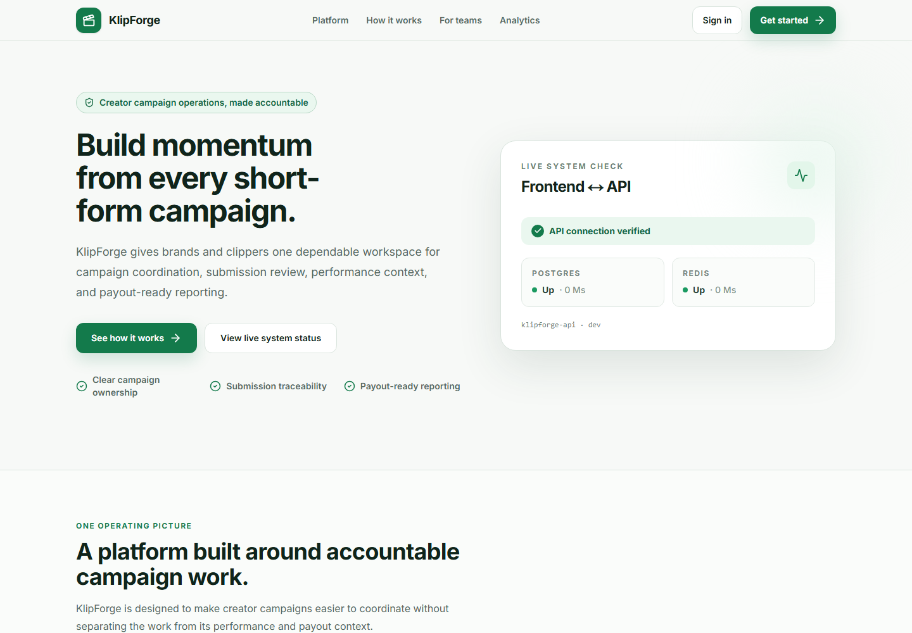
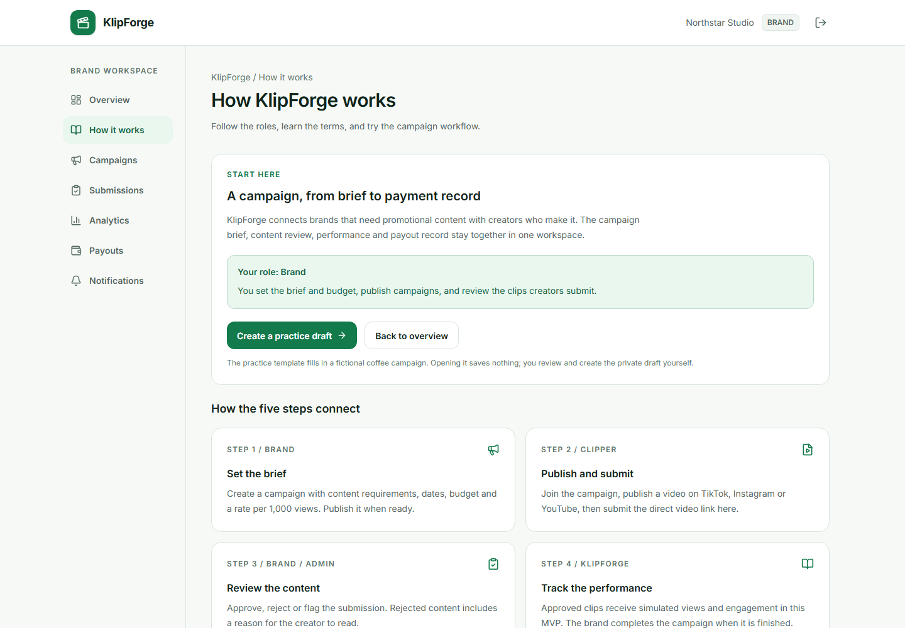
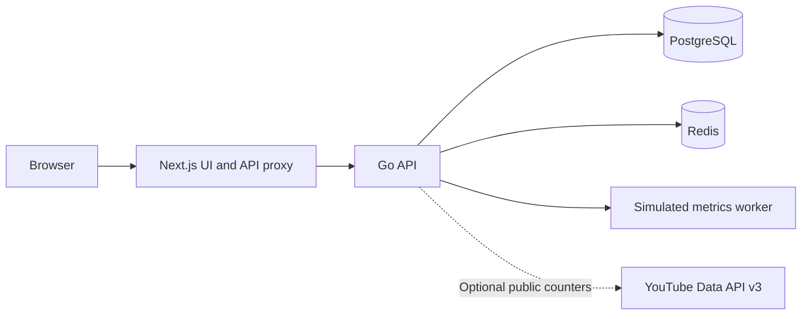

# KlipForge

A full-stack portfolio demo for managing short-form video campaigns, from a brand brief to creator submissions, moderation, analytics, and payout records.

**Status:** working demo MVP. Campaign analytics are simulated, payouts are manual records, and optional YouTube public counters are read-only.



## What you can try

| Role        | Demo capabilities                                                                                                                      |
| ----------- | -------------------------------------------------------------------------------------------------------------------------------------- |
| **Brand**   | Create a campaign, define budget and content requirements, publish it, review submitted clips, and inspect campaign performance.       |
| **Clipper** | Browse active campaigns, join, submit a published video link, edit pending submissions, and track review decisions and payout records. |
| **Admin**   | Moderate submissions, inspect analytics and rankings, manage payout records, and view the audit trail.                                 |

The workspace includes a **How it works** guide, role-specific **Your next step** prompts, a practice campaign template, accessible confirmation dialogs, review filters, and responsive layouts.



## Demo flow

1. **Brand:** create a practice draft, check its dates and requirements, then publish it.
2. **Clipper:** join the campaign and submit a direct TikTok, Instagram, or YouTube video link. KlipForge records the link; it does not upload the video.
3. **Brand:** approve, reject, or flag the submission. Complete the campaign after reviewing its clips.
4. **Admin:** inspect the simulated metrics, preview an eligible payout, reserve the campaign budget, approve it, and record a manual payment reference.
5. **Clipper:** inspect the payout status and notifications. **Admin:** inspect the corresponding audit events.

For the payout demo, the clip must be approved, the campaign completed, and a simulated metrics snapshot available. The worker collects snapshots once per minute. Use current campaign dates and separate browser profiles, or sign out when switching roles.

See the [step-by-step Indonesian demo guide](docs/panduan-demo.md).

## Tech stack

| Layer          | Technologies                                                                                           |
| -------------- | ------------------------------------------------------------------------------------------------------ |
| Frontend       | Next.js 16, React 19, TypeScript, Tailwind CSS, TanStack Query, Recharts, React Hook Form, Zod, Lucide |
| Backend        | Go, Chi, PostgreSQL 16, Redis 7                                                                        |
| Authentication | JWT access tokens, rotating refresh tokens, HttpOnly browser cookies, role and ownership checks        |
| Testing        | Vitest, Testing Library, Go unit/integration tests, Playwright                                         |
| Development    | Docker Compose, SQL migrations, deterministic development fixtures, GitHub Actions                     |



The browser talks to the Next.js API proxy. Session tokens stay in HttpOnly cookies. The Go API enforces access rules and database transactions; Redis supports caching, rate limits, and worker coordination.

## Run locally

### Fresh checkout with Docker Compose

Prerequisite: Docker with Compose support.

```bash
git clone https://github.com/tottifawwazr/klipforge.git
cd klipforge
```

Copy `.env.example` to `.env` (`cp .env.example .env` on macOS/Linux, or `Copy-Item .env.example .env` in PowerShell). Keep `.env` local. The supplied credentials and secrets are development placeholders.

```bash
docker compose up -d postgres redis
docker compose --profile tools run --rm migrate up
docker compose --profile tools run --rm seed
docker compose up --build
```

- Website: **http://localhost:3000**
- Sign in: **http://localhost:3000/login**
- API health: **http://localhost:8080/api/v1/health**

Seed only when initializing a development database. `docker compose down` stops the stack and preserves data volumes. Docker execution has not been verified on the current Windows host; the local native runtime was used for validation.

### Existing Windows development checkout

On the prepared local checkout, run from the repository root:

```powershell
powershell -ExecutionPolicy Bypass -File .\scripts\start-local.ps1
```

Open **http://localhost:3002/login**. This helper uses existing machine-local runtimes in ignored `.cache/`, which are not included in Git. A fresh checkout should use Compose above or provision Go 1.26+, Node.js 20.9+, PostgreSQL, and Redis. The current native setup was tested with Go 1.27.3 and Node.js 24.

The helper preserves existing data and services. After changing API code or the root `.env`, restart the application processes with:

```powershell
powershell -ExecutionPolicy Bypass -File .\scripts\start-local.ps1 -RestartApps
```

Local ports: web **3002**, API **8082**, PostgreSQL **54329**, Redis **16379**. Logs are under `.cache/data/`. Development uses Webpack to avoid a reproduced Turbopack HMR reload loop; the production build is unchanged.

### Demo accounts

| Role    | Email                     | Password      |
| ------- | ------------------------- | ------------- |
| Brand   | `brand@klipforge.local`   | `Brand123!`   |
| Clipper | `clipper@klipforge.local` | `Clipper123!` |
| Admin   | `admin@klipforge.local`   | `Admin123!`   |

These accounts exist only after development seeding. Public registration creates Brand or Clipper accounts; it cannot create an Admin.

## Optional YouTube public metrics

The full demo works without an external API key. To enable public counters, set the server-only variable in the root `.env`:

```dotenv
YOUTUBE_API_KEY=your_youtube_data_api_v3_key
```

Enable YouTube Data API v3 for the key, restart the API, then open **Analytics > YouTube public metrics**. Choose an approved YouTube submission and click **Load public counters**. With Compose, recreate the API service after changing its environment; with the Windows helper, use `-RestartApps`.

The panel reports public lifetime views, likes, and comments when available, with source and cache timestamps. A configured key is not proof of a successful YouTube request. These counters do not verify channel ownership and do not affect the simulated analytics or payout ledger. Never use `NEXT_PUBLIC_` for the key or commit it.

See [YouTube setup and API behavior](docs/youtube-integration.md).

## Checks

Backend, from `services/api`:

```bash
go mod verify
go vet ./...
go test -p 1 -count=1 ./...
go build ./cmd/api
```

Frontend, from `apps/web`:

```bash
npm ci
npm run format:check
npm run lint
npm run typecheck
npm test
npm run build
npx playwright install chromium --only-shell
npm run test:e2e
```

Integration tests require `TEST_DATABASE_URL` pointing to a separate migrated/seeded test database and `TEST_REDIS_URL` pointing to an isolated Redis database; otherwise they skip. Browser tests require local fixtures and web/API on ports 3002/8082. Set `E2E_START_WEB=1` to let Playwright start a built production frontend. Browser tests create QA records and never transfer money.

The GitHub Actions workflow defines backend race/integration checks, frontend checks, a production build, and the complete browser workflow using ephemeral PostgreSQL and Redis. See the workflow run for its current result.

## Demo scope

- **Simulated campaign metrics:** `METRICS_PROVIDER=mock` generates deterministic demo data. Set it to `disabled` to stop collection. There is no live TikTok or Instagram integration.
- **Manual payout records:** decimal calculations, budget reservations, idempotency, notifications, and audited state transitions are implemented. Recording a payment does not transfer money; no payment provider is connected.
- **Bounded demo lists:** campaign/submission lists, notifications, and audit views are capped at 100 records; rankings show the top 100, and payout history is paginated.
- **Portfolio MVP:** automatic transfers, channel ownership verification, password recovery, email verification, and production operations are outside the current demo scope. Development fixtures must not be exposed as public production accounts.

## Documentation

- [Demo guide (Bahasa Indonesia)](docs/panduan-demo.md)
- [API reference](docs/api.md)
- [Database schema](docs/database-schema.md)
- [Security model](docs/security.md)
- [YouTube integration](docs/youtube-integration.md)
- [Implementation plan](docs/implementation-plan.md)
- [Local verification](docs/local-verification.md)
